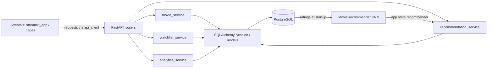
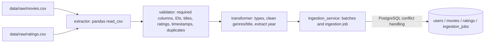
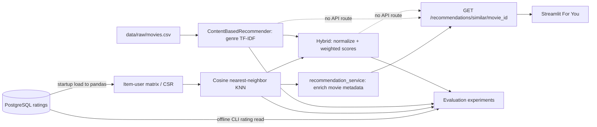
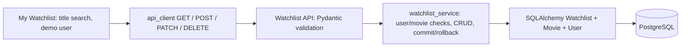
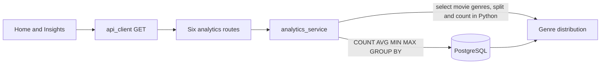

# Verified MovieVerse data flows

Solid arrows below are implemented in the inspected source. Dashed arrows are explicitly absent or future integrations. No production database calls were made for this audit.

## Serving architecture

`get_db` yields a request session and closes it afterward. The startup session reads all ratings and closes in `finally`. Database query failure or memory exhaustion stops startup; empty ratings or ordinary model training failure leave the catalogue accessible but no trained recommender. The recommendation API relies on the trained object on application state and returns 503 when it is unavailable. `/health` reports process liveness without a database call; `/ready` checks the database with `SELECT 1` and the model's trained flag. These checks do not train or load a model.

## ETL: raw CSV to tables

`load_data.py` verifies the migration head, ledger and public schema, then calls `load_movie_files` to track extraction, validation, transformation, and insertion. Movie validation requires positive integral movie IDs, nonblank title and unique movie IDs. Rating validation requires user/movie IDs, rating and timestamp, enforces positive IDs, half-star values from 0.5 through 5.0, integral timestamp and unique user/movie pairs. Transformer strips titles, fills missing genres, casts fields, and derives release year from a title suffix. The ingestion service inserts users, movies and ratings in foreign-key order in batches of 1,000 using PostgreSQL conflict handling, records inserted counts in an `IngestionJob`, commits, and rolls back on failure. Movies and ratings with changed source values are updated. Identical rows and existing derived users are skipped. Each run creates a job record. Cross-file reference errors stop before dataset inserts. The job survives rollback. Isolated tests exercise SQLite transactions and the opt-in integration test checks PostgreSQL reruns.

The Stage 1A manifest is a separate read-only inspection path: `data/raw/{movies,ratings}.csv` → streamed SHA-256 and CSV parser → JSON metadata on stdout or an explicitly chosen file. The file loader uses the same fingerprint algorithm on the bytes passed to pandas and reconciles each load with the database.

Stage 1B adds another read-only path: the manifest identifies input bytes, the existing extractors read the raw CSVs, and shared validator masks produce a JSON quality report. A movie ID or `(userId, movieId)` rating key is a duplicate when its valid numeric key appeared earlier in that file; the later row is rejected even if the earlier row has another error. Invalid keys are not treated as duplicate keys. Reason counts can overlap, while rejected-record totals use the union of row masks. The report does not transform records, alter ingestion, or test cross-file references.

Stage 1C extends that report with a read-only rating-to-movie check. Valid normalized rating movie IDs absent from valid `movies.csv` IDs are counted as orphan references and added to the existing union of rejection masks. Invalid rating movie IDs remain `invalid_id`, not orphan references. A missing movie ID column makes this check unverified rather than reporting zero orphans. The dataset fingerprint still identifies the inspected input bytes; ingestion and database behavior remain unchanged.

## Recommendation paths

`MovieRecommender.train` pivots user/movie ratings to a movie-user matrix, fills absent ratings with zero, stores a sparse CSR matrix and fits cosine `NearestNeighbors`. `recommend` finds neighboring movie IDs and similarity scores; `recommend_for_user` uses liked movies as seeds, aggregates candidate scores and excludes already-rated movie IDs. The live route exposes only `recommend` via `recommendation_service`, which performs one movie lookup for candidate metadata.

`ContentBasedRecommender.fit` builds TF-IDF vectors from pipe-separated genres and fits cosine neighbors. It supports similar movies and a weighted genre profile for a user's ratings, excluding seen movies. `hybrid_service.recommend_hybrid_for_user` combines KNN, content and popularity candidate scores with weights. `evaluation.py` computes precision/recall and random/temporal/popularity/rolling comparisons. `evaluate_recommender.py` loads CSV movie metadata and PostgreSQL ratings for offline experiments. Neither content nor hybrid has an HTTP route, and no model save/load artifact path was found. `models/` is empty. The unused, broken second `evaluate_multi_seed_model` in `model.py` was removed in Stage 0C Part 2A; the CLI continues to import the authoritative implementation from `evaluation.py`.

## Watchlist request flow

The page uses `MOVIEVERSE_DEMO_USER_ID` with fallback 1. It resolves movie titles through the movie search API, then sends IDs internally. Status values are `PLANNED`, `WATCHING`, `COMPLETED`, `DROPPED`. The list service joins movie metadata and pages results. Mutations commit; integrity/SQL errors are rolled back and mapped to HTTP errors. A prior runbook records a watchlist schema mismatch, so live operation depends on confirming migration state separately.

## Analytics request flow

The analytics service calculates totals, rating distribution, ranking, and watchlist status/movie counts from stored records. Genre distribution is a full scan of the movie `genres` column followed by a Python split and de-duplication per movie. Home uses overview, popular, top-rated and genres; Insights uses all six endpoints. Rankings use aggregates and stable tie breaks. Empty rating tables return null average/min/max and an empty distribution, while counts remain zero.

## Frontend page mapping

| Page | Implemented calls | Notes |
|---|---|---|
| Home | Analytics overview, popular, top-rated, genres; catalogue links | Uses neutral poster fallback |
| Discover | Movie list/search/detail; watchlist POST action | Genre/year filters apply to fetched page only; pagination is server-side |
| For You | Movie search; similar-movie recommendation | Title selection hides technical ID; no personalized/hybrid HTTP API |
| My Watchlist | Movie search; watchlist GET/POST/PATCH/DELETE | Demo user setting, status selection, refresh after actions |
| Insights | All six analytics GET routes | Tables and Streamlit charts use API values |
