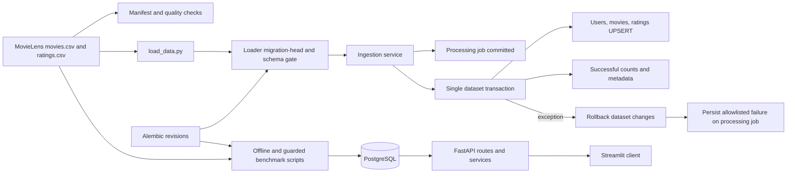

# Stage 1 learning checkpoint: Reliable Data Engineering

Stage 1 is complete. This checkpoint is a study guide and a compact verification record; measured benchmark details live in [benchmarks.md](../benchmarks.md), and current system structure is described in [the architecture overview](../architecture/ARCHITECTURE_OVERVIEW.md).

## Completion evidence

| Acceptance area | Implemented and verified evidence |
|---|---|
| Dataset identity | Streaming SHA-256 manifest; deterministic fingerprints verified against raw files |
| Data quality | Shared validators, quality report and rating-to-movie orphan check |
| PostgreSQL ingestion | Guarded local integration verifies inserts, updates, replays and transaction behavior |
| Job lifecycle | Persisted counts, timestamps, duration, fingerprint and allowlisted failure metadata |
| Incremental reconciliation | Conditional UPSERT handles inserts, corrections and unchanged records without deleting absent keys |
| Versioned schema | Frozen `0001_stage_1f` baseline and nullable-metadata `0002_ingestion_metadata`; fresh/adopted upgrade, downgrade, re-upgrade and cleanup verified |
| Loader safeguards | Resolve configured Alembic head and compare schema before creating a job or writing data; never auto-upgrade or stamp |
| Performance evidence | 81-record local PostgreSQL matrix, three repetitions for 27 dataset/batch/scenario groups; evidence retained and summarized |
| Regression/docs | Full isolated suite: 165 passed, 3 skipped, 1 existing Starlette warning in 9.61s; migration and benchmark instructions recorded |

The live database evidence is from the explicitly guarded local `movieverse_itest` database. No Render connection or raw source modification was made. The user verified cleanup and unchanged raw-file hashes after the benchmark matrix.

## Architecture walkthrough

The API is a modular monolith. HTTP routes call services; services use SQLAlchemy models and sessions. MovieLens ingestion is a batch path separate from request handling. The live similar-movie endpoint uses a KNN recommender trained at API startup; content and hybrid recommenders remain offline experiments. Streamlit calls the API and does not connect to PostgreSQL directly.

## ETL execution and transaction behavior

1. `load_data.py` resolves the expected Alembic head and checks the revision ledger and frozen schema contract before opening source files or creating a job. A current revision string cannot override detected schema drift.
2. Manifest and extraction logic identify source bytes and parse the CSVs. Validators enforce source contracts and rating-to-movie references. The quality report is read-only and can show multiple reason counts for a rejected row.
3. The ingestion service commits a `processing` job before extraction. This lets a later failure be represented even after dataset changes are rolled back.
4. Users are inserted first to satisfy foreign keys. Movies and ratings use conditional, deterministic UPSERT batches. Existing source keys can be corrected; absent keys are not deleted. Successful source counts satisfy `total = inserted + updated + unchanged`. Derived-user counts are reported separately.
5. Data writes and completion metadata share one transaction. If a write fails, that transaction rolls back. A new transaction marks the still-processing job failed with an allowlisted phase/code. Conditional failure update protects a completed job when the client loses the commit acknowledgement.
6. Batch size defaults to 1,000 and is configurable per ingestion call. Benchmark-supported values are 250, 1,000 and 2,000.
7. Alembic `0001_stage_1f` freezes the original five-table schema; `0002_ingestion_metadata` adds eight nullable fields without inventing historical values. The loader does not create tables, auto-upgrade, or stamp.

## Important files

| File | Responsibility |
|---|---|
| `app/data_pipeline/manifest.py` | Read-only CSV counts, file hashes and content fingerprint |
| `app/data_pipeline/quality_report.py` | Rejection reasons, accepted/rejected totals and referential-integrity report |
| `app/data_pipeline/extractor.py`, `validator.py`, `transformer.py` | CSV extraction, source contract checks and ORM-ready data frames |
| `load_data.py` | Loader entry point and migration-revision preflight |
| `app/services/ingestion_service.py` | Job lifecycle, batch writes, UPSERT reconciliation, transaction and metadata persistence |
| `app/database/base.py`, `models.py`, `connection.py` | Declarative metadata, ORM tables, engine and sessions |
| `alembic.ini`, `migrations/env.py`, `migrations/versions/` | Offline/guarded Alembic config, revision environment and frozen schema history |
| `scripts/baseline_verification.py`, `scripts/local_postgres_guard.py` | Frozen PostgreSQL schema comparison and local database identity guard |
| `scripts/benchmark_etl.py` | Deterministic sample generation, changed variants and offline ETL timing/memory |
| `scripts/benchmark_postgres.py` | Guarded database identity, advisory lock, Alembic setup and cleanup lifecycle |
| `scripts/benchmark_scenarios.py` | Sequential scenario coordination, timing, counts, safe child errors and JSONL output |
| `tests/test_ingestion.py`, `tests/test_migration_baseline.py`, `tests/test_loader_revision.py`, `tests/test_postgres_integration.py` | Ingestion, migration, preflight and guarded PostgreSQL regression coverage |
| `tests/test_benchmark_*.py` | Deterministic sampling, instrumentation, runner and safety unit tests |
| `docs/benchmark_results/stage1h_postgresql_matrix.jsonl` | Sanitized 81-record measured benchmark evidence |

## Engineering choices and trade-offs

- **Manifest fingerprint instead of a watermark:** inputs are static CSV files, and every run reconciles all source keys. A watermark would add state and miss corrections to earlier rows. Fingerprints identify bytes but do not skip ingestion.
- **Conditional UPSERT instead of pre-read counts:** PostgreSQL locks conflicting keys and returns inserted/updated rows. This avoids stale counts under concurrent writes, with extra database work for classification.
- **Processing job committed separately:** preserves an observable failed job if the data transaction rolls back. Completion metadata remains atomic with data.
- **Alembic frozen baseline and explicit adoption:** schema history is independent of future ORM edits. Existing schemas require a strict compare and explicit stamp authorization; the loader never repairs or adopts them.
- **Nullable metadata columns:** historical counts, fingerprints and timings stay unknown rather than being fabricated as zero.
- **Local disposable benchmark with advisory lock:** avoids external spend and limits database writes to a guarded test target. It does not represent a production server.
- **Batch default 1,000 retained:** the three-run local matrix found this the best balanced setting, but replay rankings varied and one laptop/database cannot establish a universal optimum.
- **Modular monolith retained:** orchestration, streaming and distributed tools are deferred to isolated experiments until measurable application needs exist.

## Practical debugging exercises

1. Make a copy of the raw files in a temporary directory, change one movie title, and compare manifests. Explain why generation time is excluded from the fingerprint.
2. In a synthetic SQLite fixture, create a rating referencing a missing movie. Run the quality report, then ingestion validation. Explain why the report can aggregate reasons while ingestion fails before writes.
3. Monkeypatch the rating UPSERT to raise after a movie correction. Assert that the movie correction rolls back, the job is failed, and committed source counts are zero.
4. Change a source timestamp or title without changing a primary key. Reingest and verify one update; replay the exact bytes and verify unchanged counts.
5. Make a test ledger report the expected head while the schema omits a required column. Verify loader preflight rejects it before creating an ingestion job.
6. Break a benchmark worker argument in a subprocess. Confirm diagnostics show only exception class and repository file/line, never an exception message or connection string.
7. Read the preserved matrix and independently recompute throughput, median and min/max. Explain why repeating the group memory value on all three scenario records does not mean three independent peaks.

Use isolated fixtures or the specifically guarded local test harness. Do not perform these exercises against an application database.

## Interview questions and answers

**Why is a content fingerprint not a watermark?** A fingerprint summarizes file bytes, while a watermark describes a source position or event time. The CSV loader does not use a fingerprint to skip work and has no reliable incremental source offset; it reconciles all keys on each run.

**How do you keep inserted, updated and unchanged counts correct under concurrent writes?** PostgreSQL conditional UPSERT statements lock conflicting keys, compare supplied values null-safely and use `RETURNING` to classify writes. A pre-read count could become stale before the write.

**Why commit an ingestion job before the dataset transaction?** It provides a durable processing row that can be marked failed after the data transaction rolls back. Data and successful completion fields then commit together.

**How do you handle a lost commit acknowledgement?** The client may not know whether commit succeeded. Failure handling only updates a row still in processing; it cannot replace a completed record after the server committed.

**Why verify schema when Alembic says the database is at head?** A revision ledger records migration history, not current integrity. Manual drift can leave the ledger current while columns, constraints or indexes are incompatible.

**Why use nullable metadata fields for old jobs?** Historical source fingerprints and change counts are unknown. Null distinguishes unknown from a measured zero and avoids fabricated backfills.

**What does the benchmark establish?** It measured service-call throughput and whole-child high-water working set for three MovieLens sizes, three batch sizes and three scenarios on one local Windows/PostgreSQL setup. It does not establish production-scale behavior or isolate database-server CPU and I/O.

## Small independent implementation exercises

- Add a manifest test for a duplicate CSV header and preserve the existing JSON contract.
- Add one bounded warning check to the read-only quality report without changing fail-fast ingestion policy.
- Write a test-only ingestion metric that distinguishes inserted versus updated rows for a nullable field.
- Add an offline benchmark output field for file byte totals and test JSON serialization; do not place offline timings in database timing fields.
- Design a new migration on paper first: identify upgrade, downgrade, historical-row behavior, frozen baseline impact and loader compatibility before writing a revision.

## Resume bullets grounded in this work

- **Data Engineer:** Built a transactional MovieLens ingestion pipeline with fingerprinted inputs, conditional UPSERTs and persisted change metadata; on a guarded local PostgreSQL setup, processed the full 110,578-source-row dataset at a median 9,809 rows/s for initial load across three measured repetitions.
- **Software Engineer:** Added a two-revision Alembic history, frozen-schema adoption checks and a loader preflight that rejects incompatible revisions before ingestion writes; verified migration paths with guarded local PostgreSQL and a 165-passed isolated regression suite (3 guarded tests skipped).

These bullets describe a local benchmark and test suite, not production traffic or deployment.
